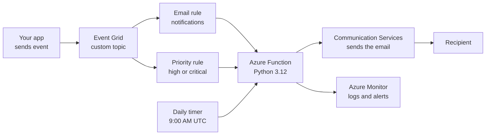

# Email Notification Automation

**An event-driven, serverless system that sends emails automatically whenever something happens in an application, built for Microsoft Azure.**


Built as part of the Women in Cloud internship.

## About the project

Companies send emails from many places: order updates, alerts and reports. When each team sends them in its own way, messages become inconsistent, late, and hard to scale or monitor.

This project puts one automatic pipeline in the middle. Any application sends a small message called an event. The pipeline picks up the event, fills a ready-made email template with its details, and sends the email. The application never talks to the email service directly.

**Who it is for**

- Developers and companies that want one reliable place to send emails from
- DevOps and support teams that need instant alert emails
- Businesses that want automatic daily reports

## How it works



1. An application sends an event to the Event Grid topic.
2. One of the rules matches it and starts the Azure Function.
3. The Function fills the email template and sends the email through Azure Communication Services.
4. Logs and errors go to Azure Monitor, which raises alerts when something fails.
5. A timer triggers the daily report on its own, with no event from an app.

When no events arrive, nothing runs and almost nothing is charged. That is what serverless means.

## Features

- **Event-driven pipeline:** apps only send events and never deal with email directly
- **Reusable HTML email template** with placeholders for subject, title, message, timestamp and source
- **Priority handling:** high and critical events get an URGENT tag in the subject
- **Safe error handling:** bad events fall back to a default recipient and log an error
- **Safe output:** message text is escaped, so it cannot inject markup into the email
- **Notification console:** send test events, preview the email, view the event JSON and a sent log
- **Works offline:** the logic and the console run on a laptop with no cloud access

## Tech stack

| Area | Technology |
| --- | --- |
| Cloud | Microsoft Azure (public cloud, serverless) |
| Compute | Azure Functions (Python 3.12) |
| Event routing | Azure Event Grid |
| Email delivery | Azure Communication Services (Email) |
| Security | Managed Identity and Azure RBAC |
| Monitoring | Azure Monitor and Application Insights |
| Local app | Python standard library, HTML, CSS, JavaScript |
| Data format | JSON |

## Project structure

| File or folder | Purpose |
| --- | --- |
| `server.py` | Local server that serves the console and accepts events |
| `email_logic.py` | Core logic that turns an event into an email |
| `email_template.html` | Email layout with placeholders |
| `requirements.txt` | Dependencies (Azure packages are added later) |
| `sample_events/` | Four test events |
| `ui/index.html` | The notification console |

## Getting started

**Requirements:** Python 3.12 or newer and a web browser. No Azure account is needed to run the local version.

Clone the repository:

```bash
git clone https://github.com/Anjali-0910/Email_Notification_Automation.git
cd Email_Notification_Automation
```

Test the core logic:

```bash
python3 email_logic.py
```

Start the console:

```bash
python3 server.py
```

Then open http://localhost:8000 in your browser. Stop the server with Ctrl + C.

> The local version builds the email and shows a preview. It does not send real emails yet. Sending is added with Azure Communication Services.

## Sample events

The event the system expects:

```json
{
  "emailConfig": { "recipient": "user@example.com", "subject": "Test Notification" },
  "title": "System Alert",
  "message": "This is a test notification."
}
```

| File | What it tests |
| --- | --- |
| `normal.json` | A regular notification |
| `priority.json` | A critical alert, the subject gets an URGENT tag |
| `bad.json` | A broken event, tests error handling and the default recipient |
| `daily_report.json` | An event with no email settings, like the scheduled report |

## Project status

| Stage | Status |
| --- | --- |
| Core email logic and HTML template | Done |
| Sample test events | Done |
| Notification console and local server | Done |
| Automated tests (pytest) | Planned |
| Azure Function with HTTP, Event Grid and Timer triggers | Planned |
| Email sending with Azure Communication Services | Planned |
| Event Grid topic and rules | Planned |
| Managed Identity and RBAC | Planned |
| Monitoring and alerts | Planned |

Azure steps start once our Azure access is available.

## Design note: AWS reference, Azure build

The reference guide for this idea was written for AWS. That guide itself cannot be deployed on Azure, because its commands, Lambda code and SES template are all AWS-specific. What carries over is the design: event, rule, function, email, monitoring. We rebuild each step with the Azure equivalent.

| Role | AWS reference | Azure (this project) |
| --- | --- | --- |
| Sends emails | Amazon SES | Azure Communication Services (Email) |
| Runs code | AWS Lambda | Azure Functions |
| Routes events | Amazon EventBridge | Azure Event Grid |
| Daily schedule | EventBridge cron rule | Timer trigger |
| Permissions | IAM | Managed Identity and RBAC |
| Logs and alarms | Amazon CloudWatch | Azure Monitor |

## Team

Anjali ([@Anjali-0910](https://github.com/Anjali-0910)) and teammate, Women in Cloud internship.